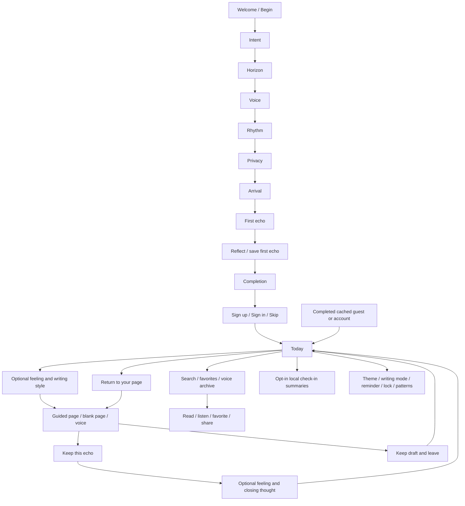

# ECHO journaling experience

The owner requested a complete premium journaling UX while preserving the existing visual design on 22 October 2026. This authorizes the functional routes, interaction copy, and extensions described here. Existing backgrounds, typography, tokens, glass controls, and the bookshelf remain the visual foundation. Immutable handoff files are unchanged.

The emotional arc is arrive, express, close, and return. Each screen gives the user one clear next action. The experience avoids streak pressure, forced AI, mandatory accounts, and repeated onboarding during daily use.

- Returning users enter Today. First-time users resume onboarding with their choices intact.
- Today offers a brief optional mood check-in and guided writing, a blank page, or voice. Prompt suggestions respond to the selected intent and horizon. The user can choose another prompt.
- Daily sessions use `/journal`, with the existing bookshelf and writing surface. Onboarding retains its existing first-echo route. Returning users can open straight to the writing page; the first bookshelf reveal remains available.
- Drafts preserve text, recording, prompt, mood, mode, and elapsed time. Existing drafts are resumed explicitly. Saving acknowledges durable encrypted storage in the native app and browser.
- `/journal-complete` closes the session with an optional after-mood and one sentence the user wants to carry forward. These are user-authored, encrypted observations, not generated AI analysis.
- Echoes becomes a searchable archive with filters, saved favorites, and `/entry/[id]` for reading and playback. New UI uses existing components and tokens.
- Patterns is opt-in, locally computed, and based on recorded check-ins and writing days. It does not infer feelings from journal text or make diagnostic claims.
- You provides working theme, reminder, journal-lock, preferred-mode, and pattern preferences. Unavailable cloud functions are described honestly.
- No journal text, mood, or reflection is written to logs, telemetry, fixtures derived from actual people, or notification bodies.

The browser stores encrypted entries, drafts, and preferences in IndexedDB. Native recording, biometric unlock, device scheduling, and native restart recovery require physical-device checks. Authentication uses the existing provider configuration; signing in does not enable cloud journal backup.

## Implemented flow

The active version uses the Welcome and eight onboarding screen compositions from the owner's `echo-mobile-foundation` folder, integrated on 25 October 2026. Fresh launch begins with Welcome → all eight steps → optional sign-up/sign-in or Skip → Today. Completed cached guest/account sessions resume Today. Earlier entry-flow decisions below are retained as history.

## Validation on 22 October 2026

- TypeScript and ESLint checks run against the updated app.
- Automated Chrome at 393 × 852: full onboarding, bookshelf opening, first save, daily mood/write/save/close/read/favorite; draft leave/resume; archive search and no-results; opt-in Patterns; theme and writing preferences; draft discard. No page runtime errors in daily/return tests.
- Synthetic repository fault tests: failed save retains draft; failed draft cleanup retries with the same ID; simultaneous submission produces one entry; closing metadata persists; voice mode cannot save text alone or an active recording; discard clears storage.
- Reviewed phone-size screenshots for Today, closing, reading, Patterns, You, and the hosted demo. Browser data is deliberately session-only.
- Expo Doctor: 20/21 checks passed; React Native Directory metadata check failed because its server returned an unexpected response. No package changes were needed.

Device acceptance still required: encrypted cold restart and interrupted recording recovery, microphone permissions, voice playback/transcription, biometric launch/background lock, reminders, Android back and keyboard behavior, and assistive technology on actual devices. Existing cloud authentication remains unchanged; cloud sync is not implemented by this UX work.

Local preview: http://localhost:8091/demo.html. Run `npm run web -- --port 8091 --localhost` if the server has stopped. State regression checks: `npm run test:ux`.

## Owner-directed experience redesign

On 22 October 2026 the owner rejected the subtle first iteration and explicitly gave open hands for a visibly premium, smooth, usable experience across the application. This supersedes the earlier functional-shell restriction and approves new daily compositions, interaction copy, geometry, motion, library/read/edit/delete flows, focused editor, simplified entry into journaling, and encrypted durable browser storage. Existing scenic assets, cream/navy material language, Cormorant/Inter typography, and native offline-first behavior remain the foundation. Immutable handoff files remain untouched.

The second iteration prioritizes direct entry (no required modal before writing), fewer required decisions, a focused paper editor, optional closing reflection, a usable personal library, and continuity across launches. No synthetic entries are inserted into the user's journal.

## Onboarding before account choice — 24 October 2026

The owner clarified that Welcome (screen 0) and all eight existing onboarding screens must begin the first-use journey. Welcome’s Begin action opens Intent, followed by Horizon, Voice, Rhythm, Privacy, Arrival, First Echo, and Completion. Completion leads to sign up / sign in, with Skip retained for local use. Returning account holders can sign in from Welcome. Completed users enter Today; interrupted onboarding resumes from its saved step. The local preview can explicitly show Welcome again without clearing local journals.

## Validation — 25 October 2026

- Automated Chrome at 393 × 852 verified Welcome and all eight steps in order, no account prompt before completion, Skip to Today, and saved first-echo reading.
- Reloading and relaunching during Rhythm and Completion resumed the correct step. Completed guest and verified account sessions returned to Today.
- Synthetic email sign-in preserved the first echo from onboarding in the account workspace. Provider calls were intercepted; no real email was sent.
- Guest-to-account retry checks preserved originals, existing account entries and edits, and existing biometric locks; failed or unavailable content did not replace data.
- Reviewed Welcome, Step 8, and 360 px account/Skip screenshots. The demo replay returned to Welcome without clearing entries.
- Typecheck, full lint, state and storage regressions passed. Expo Doctor passed 21/21 after aligning expo-notifications with SDK 57.
- Local Metro runs with two workers at http://localhost:8091. Physical-device permissions and real provider sign-in remain device/account acceptance checks.

## Restore earlier local application — 25 October 2026

The owner requested replacing the active local app with the revised earlier version and explicitly chose to keep the uploaded Figma Make project. The four revised application files were restored from that uploaded project's archive: `app/index.tsx`, `app/_layout.tsx`, `src/state/authSession.ts`, and `src/features/journal/ClosingScreen.tsx`. The onboarding-first entry behavior is no longer active. Daily premium screens, encrypted journals, account separation, and local configuration are preserved.

The replaced files and supporting demo/docs were backed up outside the mobile project at `../.echo-backups/2026-10-25-before-earlier-restore-8ddda29f/`. No journal data or environment configuration was replaced.

Restore checks passed: all 91 app/source TypeScript files match the uploaded earlier version; typecheck, lint, and state regressions pass. An isolated browser verified fresh sign-in → Skip → Today, daily save/read/reload, all eight optional onboarding steps → Today, and returning guest/account sessions with zero page errors. Authentication was intercepted with synthetic accounts.

## Translucent white content surfaces and forward icons — 25 October 2026

The owner supplied visual references and clarified that the pale content/text boxes should be translucent white, with a horizontal right-pointing direction symbol and no circle behind that symbol. Forward actions use one filled SVG arrow directly beside the label. Home's invitation, writing canvas, archive previews, reader, search, and Patterns content surfaces use a shared frosted white material: backdrop blur, a partially transparent warm-white tint, a fine border, and dark ink text. The scenery remains visible through the content boxes. This supersedes the initial fully transparent treatment. Action buttons, selected controls, toggle thumbs, and the decorative physical bookshelf keep their functional materials. The app flow and saved journal data are unchanged.

Validation: typecheck and full lint pass. Isolated Chrome checks at 393 and 360 px in both Day and Night verified the frosted material, arrows without badges, search, reading/editing, Patterns, writing starters, focus, Speak selection, draft resume, and save/read. Screenshot review caught and corrected the material's stacking over native inputs and SVG icons. Final screenshots show readable text and visible scenery, with no horizontal clipping or page errors. Checks used synthetic accounts and entries; no real authentication messages were sent. Actual device blur and microphone acceptance remain device checks. The local preview runs at http://localhost:8091 with live updates enabled.

## Borderless surfaces — 25 October 2026

The owner requested removal of border lines wherever present. This approves removing UI container and button outlines, input borders and underlines, decorative rules, card edges, and section separators throughout the main app, account screens, and onboarding. Translucent materials and spacing continue to distinguish the content. Selection and focus use fills rather than outlines. Icon strokes, dial ticks, progress indicators, and book illustration details retain their meaning; navigation, persistence, and journal behavior are unchanged.

Validation: isolated Chrome checks verified no visible app container borders on Home in Day/Night at 393/360 px, focused inputs and primary buttons, journal starters, closing, saved-page editing, archive/search/filter selection, Patterns, You, sign-in, and all eight onboarding steps. Writing, saving, reading, and onboarding completed with zero runtime errors. Screenshot review verified the focused editor also has no browser auto-outline. Synthetic data was used, and no real authentication messages were sent. Typecheck and full lint passed without diagnostics.

## Foundation onboarding at first launch — 25 October 2026

The owner named `../echo-mobile-foundation` as the source for Welcome and the eight onboarding pages and requested those screens at the start of the active mobile application. Their compositions are imported into the existing routes, using the already-matching assets and compatible shared components. The previous borderless styling remains. The source's standalone first-echo writing screen replaces the bookshelf at step 7; the source's saved-privately composition returns at step 8. Current encrypted saves, draft recovery, biometric authentication, and account separation are retained. Unavailable private backup remains clearly unavailable, and importing the completion UI does not authorize sending journal text for remote reflection.

Fresh installation opens a local onboarding workspace without asking for an account. Welcome → Intent → Horizon → Voice → Rhythm → Privacy → Arrival → First Echo → Completion precedes optional sign-up/sign-in or Skip, followed by Today. Skip does not mark unfinished onboarding complete. Saved interrupted progress resumes; already-completed guest/account sessions open Today. The explicit `/?welcome=1` preview shows Welcome without clearing journals or preferences.

Validation: typecheck, targeted lint, journal state regressions, and guest/account transfer regressions passed. Isolated browser runs completed all eight imported screens through both Skip and mocked email sign-in, preserved the first echo after reload/account transfer, resumed interrupted Rhythm, and returned completed cached sessions to Home. Welcome, first echo, and completion screenshots were reviewed at 393 and 360 px. No page errors or real provider messages occurred.

## Slim forward arrow — 25 October 2026

The owner requested a slimmer direction symbol. The shared forward arrow now uses a 1.5 pt open stroke with rounded ends and joins, matching the existing line-icon weight. This replaces the heavy filled shape everywhere that uses the shared icon. Arrows remain horizontal and have no circular badge; button sizes and navigation are unchanged.

## Intent dotted path — 25 October 2026

The owner supplied a screen-1 reference and explicitly requested its dotted trail. Restore the existing rounded white dotted path between the four Intent choices. It uses the same reference coordinates as the choice markers, offset by the stage's safe-area origin, so the path meets the markers without stretching. This decorative path is an explicit exception to the earlier border/divider removal; the remaining borderless styling is preserved.

## Round option markers without stems — 25 October 2026

The owner requested removal of the short solid connector lines beside round choice markers. Horizon and Voice now use an invisible spacing element between the circular marker and its copy. Shared option geometry, selection states, and touch areas remain intact. The separately requested dotted path on Intent remains visible.

## Home without arrival check-in and anchored navigation — 25 October 2026

The owner requested removal of Home's optional "How are you arriving?" section, including its expandable feeling choices. A new daily writing session starts without a pre-writing mood; resuming an existing draft preserves its saved mood. Onboarding and optional closing feelings are unchanged.

The four main tabs now sit in a full-width navigation base flush with the bottom of Home, Echoes, Patterns, and You. The dark glass background covers the bottom safe area, with no floating capsule or external gutter below it. The navigation remains outside scrolling content, and its reserved layout space prevents it from covering the last content item. Onboarding and focused writing retain their existing navigation.

Validation: typecheck and affected-file lint passed. Isolated browser checks at 393×852, 360×740, and 568×852 verified all four routes, full-width/bottom alignment, safe-area coverage, stationary navigation during scrolling, selected-tab accessibility, and removal of Home's arrival text and mood choices. Daily writing → save → read passed with zero runtime errors. Phone-size screenshots were visually reviewed; synthetic accounts and entries were used, with no real provider messages.

## Compact bottom navigation — 25 October 2026

The owner highlighted the empty block below the tab buttons and requested its removal. The navigation base now uses actual device safe-area insets instead of the onboarding preview's artificial 34 pt bottom floor. The web tab bar is therefore 72 pt tall, with no blank block beneath its row. Native devices still reserve their actual gesture/home-indicator inset. All four main routes use the shared compact bar.

## ECHO wordmark switches appearance — 25 October 2026

The owner requested that tapping ECHO anywhere switch the application's colours. Interactive brand wordmarks now share one accessible Day/Night toggle wired to the existing persisted appearance setting. Welcome, onboarding headers, account screens, Home, the main tab screens, and daily closing use the same action. A normal tap works in production; the previous onboarding development-only long press and the main wordmark's navigation-to-Today action are superseded. The active screen, journal text, and selected onboarding choices stay in place while the appearance changes.

Validation: typecheck and affected-file lint passed. Isolated browser checks verified forward/reverse toggles on Welcome, Intent, sign-in, all four main tabs, and daily closing, without route changes. Onboarding selection and saved journal text remained intact, and the chosen appearance survived reload. Day/Night Home screenshots were reviewed; zero runtime errors or real provider messages occurred.

## ECHO wordmark requires a double tap — 29 October 2026

The owner requested that ECHO change the screen colours only on a double tap/click, not a single tap/click. This supersedes the normal-tap action above. All existing interactive wordmarks use the shared toggle: two presses within 350 ms switch Day/Night once, while isolated presses do nothing. The active route, layout, journal content, and persisted appearance behaviour are unchanged. Keyboard activation and the screen-reader activate action remain available without requiring two separate accessibility activations.

Validation: typecheck, application-source lint (`app/`, `src/`, `scripts/`), `test:theme-toggle`, and `test:ux` passed. Isolated browser checks verified that single/slow clicks do nothing and double clicks switch once on Welcome, Intent, sign-in, all four main tabs, and daily closing. Touchscreen emulation, keyboard activation, route stability, reload persistence, and preservation of synthetic journal content passed with no runtime errors or real provider messages. Welcome and Home Day/Night screenshots were reviewed at 393×852; wordmark geometry is unchanged. The whole-tree lint probe separately found existing errors in generated `.expo/` QA/export scripts; these files were left untouched.

## Echo Avatar and companion — 25 October 2026

The owner requested Echo Avatar under You → Make it yours, with the supplied pet collection adapted to a compact mobile picker and a GPT-5.6 Luna companion. The native vector kit contains Codex, Dewey, Fireball, Hoots, Rocky, Seedy, Stacky, BSOD, Null Signal, and None. These are original vector interpretations of the supplied reference, not an imported proprietary asset kit. Small transparent sprites, selected fills, and reduced-motion-aware animation fit the existing borderless glass design. Avatar choice uses the existing scoped settings persistence, defaults to Codex, and None hides the companion.

The selected pet appears above the four main navigation tabs and opens a temporary conversation. It is mounted once per private workspace, remains across main-tab navigation, and is removed when the workspace changes or the journal locks. Conversations are not written to device storage or logs. No journal entry or audio is automatically included: only explicitly typed chat messages are sent after the user presses Send.

The existing Fastify backend calls the OpenAI Responses API with model `gpt-5.6-luna`, bounded input/output, and `store: false`. The user-provided key is configured only in the backend's ignored `.env.local`; the mobile bundle contains only a public endpoint. Production chat requires verified account authentication. The local demo permits guest chat only with explicit server opt-in, a loopback connection, and an approved local browser origin. No deployment or database migration is part of this change.

Validation: mobile typecheck, affected lint, journal state and guest-transfer checks passed. Backend typecheck, build, formatting, OpenAPI checks, and the full serialized suite passed (43 tests; 18 existing environment-dependent tests skipped). Picker and conversation screenshots were reviewed at 393 and 360 px. Browser checks covered all 10 choices, persisted selection, None/hide, manual-message-only payloads, request bounds, busy/error/retry behavior, scrollable conversation bounds, tab continuity, reload clearing, and account-workspace isolation. One short synthetic conversation completed end to end from the browser through the local API to real GPT-5.6 Luna. No journal content, credentials, or replies were logged. A client-source scan found zero occurrences of the provider key.

## Movable companion on every screen — 29 October 2026

The owner asked for the pet to appear on every screen and to be movable instead of fixed above the tabs, where it covered row values. It now floats over every route of the private workspace (onboarding, journal, entries and the tabs) as the bare sprite: the glass tile is transparent and the close (×) button is removed at the owner's request; None in Echo Avatar still hides it. A drag of more than 8 pt moves it anywhere inside the safe area, 16 pt from its edges so side grabs stay out of the system back-swipe strips, and a shorter touch still opens the conversation. The drop position is saved in the same scoped settings as the avatar choice and is clamped back on screen if the screen size changes. The default spot is unchanged: bottom right, above the tab bar. It is still removed while the journal is locked and is not shown on the signed-out sign-in screen.

## Bookshelf opens the first echo — 30 October 2026

The owner asked that step 7 open through the library animation, with the Write/Speak screen on the book's page in a paper, textbook style. Step 7 again uses the journal-session bookshelf: the ECHO Volumes roll to Your Echo, tapping it swings the cover open onto the first question, and the book turns to a lined paper page with Write and Speak, the writing area, recording, and the word and time count. Reflect saves the first echo and continues to step 8. A resumed draft opens straight onto the writing page, and reduced motion skips the roll. This supersedes the 25 October replacement of the bookshelf at step 7. The replaced standalone screen is backed up at `../.echo-backups/2026-10-30-before-step7-book-page/`.
